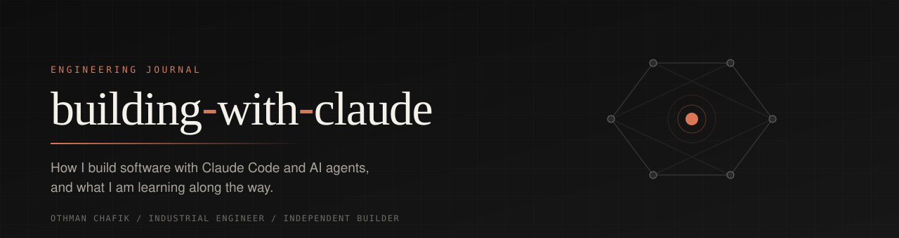
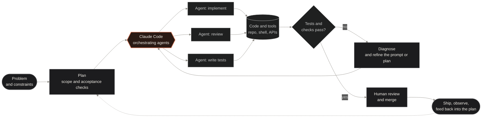

 

 

## A note on what this is

I am an industrial engineer who builds software products with AI as a core part of the process. This repository is a short, honest account of **how I work with Claude Code**: the habits, the structure and the experiments behind the things I build.

It is a portfolio of method rather than a code dump. Source for my products stays private, and nothing here is padded with numbers I cannot back up.

## Background

I graduated in industrial engineering in 2024. That training shaped how I approach software: look for the bottleneck, make the process visible, change one thing at a time, and measure before claiming improvement. Lean and continuous-improvement thinking carries over to AI-assisted development more directly than I expected.

I now work as an independent builder. The through-line is simple: I like turning a real problem into a working product, and I learn fastest by shipping and iterating.

## Current work

Each item is labelled **Current** (exists and is in use or in progress today) or **Exploring** (an experiment or direction, not a finished capability).

| Area | Status | What it is |
| :-- | :-- | :-- |
| **Education SaaS** | Current | A SaaS platform for private education, built with AI-assisted development (React, TypeScript, Supabase). |
| **Claude Code workflows** | Current | Day-to-day use of Claude Code for planning, implementation, refactoring and review. |
| **Multi-agent setups** | Exploring | Running several Claude agents with distinct roles and comparing how they coordinate. |
| **Agent orchestration** | Exploring | Structuring hand-offs between agents, tools and human review. |
| **JEV AI** | Exploring | Experiments alongside my Claude Code workflow. |
| **Code optimization** | Exploring | Using agents to profile, simplify and tighten code, with tests as the arbiter. |
| **Autonomous crypto research lab** | Current, early stage | See below. |

## How I work with agents

The workflow I keep returning to is a loop, not a straight line. Tests and review decide what survives; the model does not get the last word.

A few principles behind it:

- **Define "done" before generating anything.** Acceptance checks come first, so the agents have something concrete to be judged against.
- **Separate roles.** The agent that writes code is not the one that reviews it.
- **Keep a human in the merge path.** I read what ships.
- **Let failures teach the process.** A failing test usually points to a weak plan or prompt, which I fix before retrying.

## Autonomous crypto research lab

I am building a research environment for studying how AI-driven systems can support analysis of crypto markets. It is **research-stage work**.

What I can say publicly:

- The focus is on research tooling and experimentation, with agents assisting the analysis loop.
- Engineering discipline matters more here than anywhere else: reproducibility, clear separation between research and execution, and conservative assumptions.

What I am deliberately **not** claiming or sharing:

- No performance results, returns or backtest figures are published.
- No claim that it trades live or is profitable.
- Strategies, signals, parameters and infrastructure details stay private.

## Why I build

I build because I want useful products to exist, and because working with AI tooling at the edge of what it can do teaches me things I would not learn otherwise. I am interested in where agentic development genuinely helps and where it does not.

What I hope to contribute to the ecosystem:

- Practical, candid notes on agent workflows, including what failed.
- Patterns for keeping AI-assisted code testable, reviewable and maintainable.
- A perspective from process engineering: treat the development loop as a system to be measured and improved.

## Note for the Anthropic team

This repository presents my work and my way of building. It is a portfolio, and it does not imply eligibility for any program; that decision is yours.

If it is useful for your review, I am happy to share **relevant Claude Code sessions or selected workflows**, curated and with private code, credentials and personal data removed. I will not publish raw session logs here.

## Find me

[**GitHub**](https://github.com/othmanch-oss) &nbsp;&middot;&nbsp; [**LinkedIn**](https://www.linkedin.com/in/othman-chafik/)

Othman Chafik &middot; France

